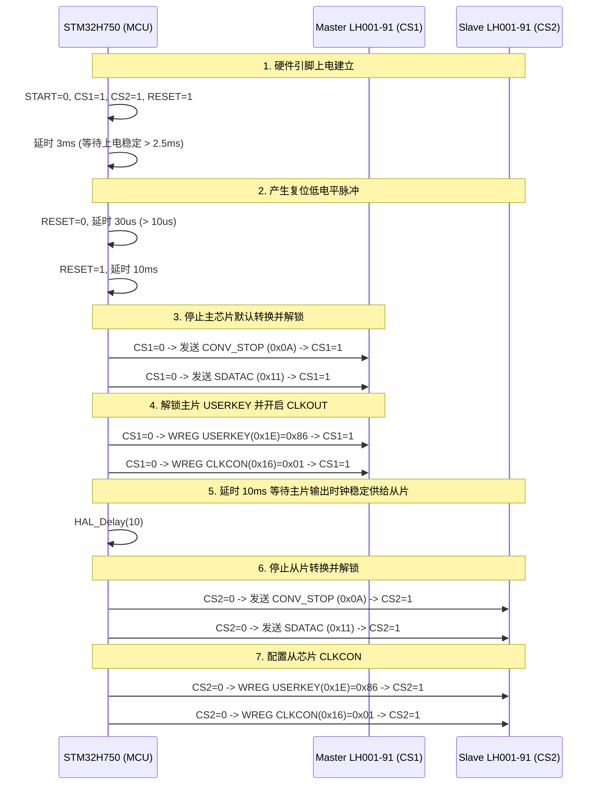

# LH001-91 双芯片 ECG 采集芯片驱动实现文档 (`LH001_91.c`)

本文档根据 [LH001_91.c](file:///D:/Software_dev/STM32H750/LH001-91FIFO/Core/HardWare/LH001_91.c) 转换生成，系统地记录了 **LH001-91** 双芯片（Master 主片 / Slave 从片）生物电/心电信号采集芯片的底层驱动实现机制、寄存器读写逻辑、FIFO 突发读取以及模拟前端初始化的完整技术细节。

---

## 目录
- [一、 模块概述与硬件拓扑](#一-模块概述与硬件拓扑)
- [二、 寄存器寻址与 Bank 切换机制](#二-寄存器寻址与-bank-切换机制)
- [三、 核心工作流程与时序](#三-核心工作流程与时序)
  - [3.1 硬件复位与主从级联时钟分发](#31-硬件复位与主从级联时钟分发)
  - [3.2 FIFO 帧结构与解析](#32-fifo-帧结构与解析)
- [四、 API 接口详解](#四-api-接口详解)
- [五、 完整源代码 (`LH001_91.c`)](#五-完整源代码-lh001_91c)

---

## 一、 模块概述与硬件拓扑

### 1.1 模块职责
`LH001_91.c` 实现了 LH001-91 心电芯片的全部基础控制功能：
1. **硬件复位与时钟级联**：上电时序控制、主芯片内部振荡器使能并通过 `CLKOUT` 为从芯片供钟、主从芯片同步解锁与转换控制。
2. **多 Bank 寄存器访问**：支持 Bank 0、Bank 1 及扩展地址寄存器的透明读写。
3. **FIFO 采集与批量读取**：支持 32 深度硬件 FIFO 阈值中断配置、24-bit ADC 原始数据解包与状态位判定。
4. **模拟前端子系统配置**：包含调制时钟 (MODCLK)、基准源 (BUFCON)、过采样率与转换模式 (CONFIG1)、可编程增益放大器 (PGA)、导联脱落检测 (Lead-Off)、右腿驱动电路 (RLD) 以及输入通道选择。

### 1.2 硬件主从拓扑
```
               +--------------------------------------------+
               |             STM32H750 主控 MCU             |
               +--------------------------------------------+
                 |       |           |           |        |
             SPI_CS1  SPI_CS2     SPI_SCK     SPI_MOSI  SPI_MISO
                 |       |        (共通)       (共通)    (共通)
                 v       |           |           |        |
         +-------------+ |           |           |        |
         |   Master    | |           |           |        |
         |  LH001-91   | |           |           |        |
         | (Chip ID 0) | |           |           |        |
         +-------------+ |           |           |        |
           | CLKOUT      |           |           |        |
           +-------------+-----------+-----------+--------+
                         |           |           |        |
                         v           |           |        |
                   +-------------+   |           |        |
                   |    Slave    |   |           |        |
                   |  LH001-91   |<--+-----------+--------+
                   | (Chip ID 1) |
                   +-------------+
```

- **片选控制**：主芯片使用 `CS1`，从芯片使用 `CS2`。
- **时钟供给**：主芯片作为时钟源（配置 `CLKCON` 开启 `CLKOUT` 输出 2.048MHz），从芯片通过时钟输入引脚接收主芯片时钟，确保双芯片完全时钟同源与相位同步。
- **复位与启动**：硬件 `START` 与 `RESET (PDEXTRST)` 引脚共用，支持一键硬件复位与同步启动/停止。

---

## 二、 寄存器寻址与 Bank 切换机制

LH001-91 内部寄存器空间超过单一 5-bit 地址范围（0x00~0x1F），驱动通过特定的指令前缀和扩展控制寄存器实现多 Bank 寻址：

| 地址范围 (`addr`) | 访问类型 | SPI 命令码 / 寻址机制 |
| :--- | :--- | :--- |
| **0 ~ 31** (0x00~0x1F) | **Bank 0** 标准寄存器 | 写: `0x40 \| (addr & 0x1F)`<br>读: `0x20 \| (addr & 0x1F)` |
| **32 ~ 62** (0x20~0x3E) | **Bank 1** 寄存器 | 写: `0xC0 \| (addr & 0x1F)`<br>读: `0xA0 \| (addr & 0x1F)` |
| **63** (0x3F) | **Bank 1 特殊寄存器** | 先发送 Bank 1 写命令 `0xC0 \| 0x1F`，数据段包含解锁码 `0x72` |
| **≥ 64** | **扩展 Bank 寄存器** | 1. 写入 `0x72 0x01` 到 Bank 1 的 31 号寄存器开启扩展映射；<br>2. 读写目标寄存器（根据范围映射到 0x40 或 0xC0）；<br>3. 写入 `0x72 0x00` 关闭扩展映射。 |

---

## 三、 核心工作流程与时序

### 3.1 硬件复位与主从级联时钟分发 (`lh001_91_hw_reset`)

复位与初始化流程必须严格遵守芯片上电时序要求：



### 3.2 FIFO 帧结构与解析

每个采样点在 SPI 总线上传输 6 个字节（48 bits），格式解析如下：

```
+---------------+---------------+---------------+---------------+---------------+---------------+
|    Byte 0     |    Byte 1     |    Byte 2     |    Byte 3     |    Byte 4     |    Byte 5     |
+---------------+---------------+---------------+---------------+---------------+---------------+
| [7:4] | [3:0] | [7:6] | [5:4] | [3:2] | [1:0] | [7:0]         | [7:0]         | [7:2]   | [1:0]|
| START | LOFF1 | LOFF2 | GPIO  | RSV1  | DATA  | DATA [21:14]  | DATA [13:6]   | DATA    | TAIL |
| (4b)  | (4b)  | (2b)  | (2b)  | (6b)  | [23:22]               |               | [5:0]   | (2b) |
+---------------+---------------+---------------+---------------+---------------+---------------+
```

- **`start`** (4-bit): 帧头同步标志。
- **`loffstat`** (6-bit): `(Byte0[3:0] << 2) | (Byte1[7:6])` 导联脱落状态。
- **`gpio`** (2-bit): `Byte1[5:4]` 芯片 GPIO 输入状态。
- **`data`** (24-bit): `(Byte2[1:0] << 22) | (Byte3 << 14) | (Byte4 << 6) | (Byte5 >> 2)` 补码格式心电数据。
- **`tail`** (2-bit): `Byte5[1:0]` FIFO 状态标志：
  - `0x00`: 普通中间数据点；
  - `0x01`: 本批次突发读取末尾点；
  - `0x02`: FIFO 已读空 (EMPTY)；
  - `0x03`: FIFO 发生溢出 (OVERFLOW)。

---

## 四、 API 接口详解

### 4.1 硬件复位与转换控制

#### `lh001_91_hw_reset`
- **原型**：`void lh001_91_hw_reset(void);`
- **说明**：执行完整的双芯片上电复位、SDATAC 解锁及时钟级联配置。

#### `lh001_91_adc_go_dual` / `lh001_91_adc_stop_dual`
- **原型**：
  ```c
  void lh001_91_adc_go_dual(LH001_91_Chip_ID_t chip_id);
  void lh001_91_adc_stop_dual(LH001_91_Chip_ID_t chip_id);
  ```
- **说明**：启动/停止指定芯片（或硬件 START 引脚）的 ADC 模数转换。

#### `lh001_91_reset_fifo_hw` / `lh001_91_reset_fifo_cmd`
- **原型**：
  ```c
  void lh001_91_reset_fifo_hw(void);
  void lh001_91_reset_fifo_cmd(void);
  ```
- **说明**：复位硬件 FIFO 状态机，清除内部残留未读数据。

---

### 4.2 寄存器读写接口

#### `lh001_91_write_regs_dual` / `lh001_91_read_regs_dual`
- **原型**：
  ```c
  void lh001_91_write_regs_dual(LH001_91_Chip_ID_t chip_id, uint8_t addr, uint8_t *pRegs, uint8_t num);
  void lh001_91_read_regs_dual(LH001_91_Chip_ID_t chip_id, uint8_t addr, uint8_t *pRegs, uint8_t num);
  ```
- **参数**：
  - `chip_id`: `LH001_91_CHIP_MASTER` (0) 或 `LH001_91_CHIP_SLAVE` (1)。
  - `addr`: 目标寄存器地址（支持 Bank 0、Bank 1 及扩展地址）。
  - `pRegs`: 数据缓冲区指针。
  - `num`: 读写字节数。

---

### 4.3 FIFO 配置与突发读取

#### `lh001_91_fifo_setup_dual`
- **原型**：`void lh001_91_fifo_setup_dual(LH001_91_Chip_ID_t chip_id, uint8_t thresh_num);`
- **说明**：使能 FIFO 模式，配置 `INTOEN` 使能 `ENOUGH` 阈值中断，设置 `FIFOSTA` 水位阈值为 `thresh_num - 1`。

#### `lh001_91_read_fifo_burst_dual_num`
- **原型**：`void lh001_91_read_fifo_burst_dual_num(LH001_91_Chip_ID_t chip_id, LH001_91_FIFO_BURST_t *pBurst, uint8_t expected_count);`
- **说明**：连续发送 `RDATA` 指令读取 `expected_count` 个采样点，自动解析 6 字节原始数据并填充结构体，若遇到 `EMPTY (0x02)` 或 `OVERFLOW (0x03)` 会提前中断并记录异常状态。

---

### 4.4 模拟前端与辅助接口

#### `lh001_91_adc_init_dual` / `lh001_91_pga_init_dual`
- **原型**：
  ```c
  void lh001_91_adc_init_dual(LH001_91_Chip_ID_t chip_id, LH001_91_ADC_INIT_t *pInit);
  void lh001_91_pga_init_dual(LH001_91_Chip_ID_t chip_id, LH001_91_PGA_INIT_t *pInit);
  ```
- **说明**：配置 ADC 采样率、基准电压、单次/连续转换模式、PGA 增益与斩波频率等。

#### `lh001_91_adc_code2mv`
- **原型**：`float lh001_91_adc_code2mv(uint32_t code, uint32_t ref);`
- **说明**：将 24 位补码原始 ADC 码值转换为毫伏 (mV) 电压值：
  $$\text{Voltage (mV)} = \frac{\text{SignedData} \times 2.0 \times \text{Ref}}{6.0 \times (2^{24} - 1)}$$

---

## 五、 完整源代码 (`LH001_91.c`)

以下为 [LH001_91.c](file:///D:/Software_dev/STM32H750/LH001-91FIFO/Core/HardWare/LH001_91.c) 的完整源代码：

```c
/**
  ******************************************************************************
  * @file           : LH001_91.c
  * @brief          : LH001-91 ECG Chip Driver Implementation (Dual-Chip Master/Slave)
  * @author         : LH Software Group
  ******************************************************************************
  */

#include "LH001_91.h"
#include <string.h>

/* Private Helper Functions --------------------------------------------------*/

static void lh001_91_cs_clr(LH001_91_Chip_ID_t chip_id)
{
    if (chip_id == LH001_91_CHIP_MASTER) {
        SPI_CLR_CS1();
    } else if (chip_id == LH001_91_CHIP_SLAVE) {
        SPI_CLR_CS2();
    }
}

static void lh001_91_cs_set(LH001_91_Chip_ID_t chip_id)
{
    if (chip_id == LH001_91_CHIP_MASTER) {
        SPI_SET_CS1();
    } else if (chip_id == LH001_91_CHIP_SLAVE) {
        SPI_SET_CS2();
    }
}

/* ============================================================================
 * 1. Hardware Reset & ADC Control Functions
 * ============================================================================ */

void lh001_91_hw_reset(void)
{
    /* 1. 上电建立 (Power-On Setup) */
    LH001_91_START_CLR();       // 保持 START 引脚为低电平
    SPI_SET_CS1();              // 释放主芯片片选
    SPI_SET_CS2();              // 释放从芯片片选
    LH001_91_PDEXTRST_SET();    // 保持复位引脚为高电平
    HAL_Delay(3);               // 延时 3ms，等待上电稳定（手册要求 > 2.5ms）

    /* 2. 硬件复位 (Hardware Reset Pulse) */
    LH001_91_PDEXTRST_CLR();    // 产生复位低电平脉冲
    LH001_91_DELAY_10US();
    LH001_91_DELAY_10US();
    LH001_91_DELAY_10US();      // 延时 30us，确保低电平脉宽 > 10us
    
    LH001_91_PDEXTRST_SET();    // 拉高复位引脚
    HAL_Delay(10);              // 延时 10ms

    /* 2.5. 停止主芯片转换 (Stop Master Conversion) */
    SPI_CLR_CS1();
    LH001_91_SpiTxRxByte(SPI_CMD_CONV_STOP);
    SPI_SET_CS1();
    LH001_91_DELAY_10US();

    /* 3. 解锁主片 (Unlock Master - SDATAC) */
    SPI_CLR_CS1();
    LH001_91_SpiTxRxByte(SPI_CMD_SDATAC);
    SPI_SET_CS1();
    LH001_91_DELAY_10US();

    /* 4. 主片供钟 (Configure Master to Output Clock) */
    SPI_CLR_CS1();
    LH001_91_SpiTxRxByte(0x5E); // WREG USERKEY (0x1E)
    LH001_91_SpiTxRxByte(0x00);
    LH001_91_SpiTxRxByte(0x86); // 解锁码 0x86
    SPI_SET_CS1();
    LH001_91_DELAY_10US();

    SPI_CLR_CS1();
    LH001_91_SpiTxRxByte(0x56); // WREG CLKCON (0x16)
    LH001_91_SpiTxRxByte(0x00);
    LH001_91_SpiTxRxByte(0x01); // 使能 CLKOUT
    SPI_SET_CS1();
    LH001_91_DELAY_10US();

    /* 5. 解锁从片 (Unlock Slave - SDATAC) */
    HAL_Delay(10);               // 等待主片输出时钟稳定供给从片
    SPI_CLR_CS2();
    LH001_91_SpiTxRxByte(SPI_CMD_CONV_STOP);
    SPI_SET_CS2();
    LH001_91_DELAY_10US();

    SPI_CLR_CS2();
    LH001_91_SpiTxRxByte(SPI_CMD_SDATAC);
    SPI_SET_CS2();
    LH001_91_DELAY_10US();

    /* 6. 配置从芯片 CLKCON */
    SPI_CLR_CS2();
    LH001_91_SpiTxRxByte(0x5E); // WREG USERKEY
    LH001_91_SpiTxRxByte(0x00);
    LH001_91_SpiTxRxByte(0x86);
    SPI_SET_CS2();
    LH001_91_DELAY_10US();

    SPI_CLR_CS2();
    LH001_91_SpiTxRxByte(0x56); // WREG CLKCON
    LH001_91_SpiTxRxByte(0x00);
    LH001_91_SpiTxRxByte(0x01);
    SPI_SET_CS2();
    LH001_91_DELAY_10US();
}

void lh001_91_adc_go_dual(LH001_91_Chip_ID_t chip_id)
{
#if ADC_CONV_START_HW
    LH001_91_START_SET();
#else
    lh001_91_cs_clr(chip_id);
    LH001_91_DELAY_10US();

    LH001_91_SpiTxRxByte(SPI_CMD_CONV_START);
    LH001_91_DELAY_10US();
    lh001_91_cs_set(chip_id);
#endif
}

void lh001_91_adc_stop_dual(LH001_91_Chip_ID_t chip_id)
{
#if ADC_CONV_START_HW
    LH001_91_START_CLR();
#else
    lh001_91_cs_clr(chip_id);
    LH001_91_DELAY_10US();

    LH001_91_SpiTxRxByte(SPI_CMD_CONV_STOP);
    LH001_91_DELAY_10US();
    lh001_91_cs_set(chip_id);
#endif
}

void lh001_91_reset_fifo_hw(void) 
{
#if ADC_CONV_START_HW
    LH001_91_START_CLR();
    LH001_91_DELAY_10US();
    LH001_91_START_SET();
#else
    lh001_91_adc_stop_dual(LH001_91_CHIP_MASTER);
    lh001_91_adc_stop_dual(LH001_91_CHIP_SLAVE);
    LH001_91_DELAY_10US();
    lh001_91_adc_go_dual(LH001_91_CHIP_MASTER);
    lh001_91_adc_go_dual(LH001_91_CHIP_SLAVE);
#endif
}

void lh001_91_reset_fifo_cmd_dual(LH001_91_Chip_ID_t chip_id)
{
    lh001_91_cs_clr(chip_id);
    LH001_91_DELAY_10US();
    LH001_91_SpiTxRxByte(SPI_CMD_RST_FIFO);
    LH001_91_DELAY_10US();
    lh001_91_cs_set(chip_id);
}

void lh001_91_reset_fifo_cmd(void)
{
    lh001_91_reset_fifo_cmd_dual(LH001_91_CHIP_MASTER);
    lh001_91_reset_fifo_cmd_dual(LH001_91_CHIP_SLAVE);
}

/* ============================================================================
 * 2. Register Read & Write Functions (Supports Dual-Chip & Banking)
 * ============================================================================ */

void lh001_91_write_regs_dual(LH001_91_Chip_ID_t chip_id, uint8_t addr, uint8_t *pRegs, uint8_t num)
{
    if (pRegs == NULL || num == 0) {
        return;
    }
    uint8_t *p = pRegs;
    uint8_t reg_addr;
#if SOFTWARE_SPI_CS
    lh001_91_cs_clr(chip_id);
    LH001_91_DELAY_10US();
#endif

    reg_addr = addr & 0x1F;

    if (addr < 32) {
        LH001_91_SpiTxRxByte(SPI_CMD_WREG_MSK | reg_addr);
        LH001_91_SpiTxRxByte(num - 1);
        for (uint8_t i = 0; i < num; i++) {
            LH001_91_SpiTxRxByte(p[i]);
        }
    } else if (addr < 63) {
        LH001_91_SpiTxRxByte(SPI_CMD_WREG_BK1_MSK | reg_addr);
        LH001_91_SpiTxRxByte(num - 1);
        for (uint8_t i = 0; i < num; i++) {
            LH001_91_SpiTxRxByte(p[i]);
        }
    } else if (addr == 63) {
        LH001_91_SpiTxRxByte(SPI_CMD_WREG_BK1_MSK | reg_addr);
        LH001_91_SpiTxRxByte(0);
        LH001_91_SpiTxRxByte(0x72);
        LH001_91_SpiTxRxByte(p[0]);
    } else {
        // extend address mapping
        LH001_91_SpiTxRxByte(SPI_CMD_WREG_BK1_MSK | 31);
        LH001_91_SpiTxRxByte(0);
        LH001_91_SpiTxRxByte(0x72);
        LH001_91_SpiTxRxByte(0x01);

#if SOFTWARE_SPI_CS
        LH001_91_DELAY_10US();
        lh001_91_cs_set(chip_id);
#endif

#if SOFTWARE_SPI_CS
        lh001_91_cs_clr(chip_id);
        LH001_91_DELAY_10US();
#endif

        if (addr < (64 + 32)) {
            LH001_91_SpiTxRxByte(SPI_CMD_WREG_MSK | reg_addr);
        } else {
            LH001_91_SpiTxRxByte(SPI_CMD_WREG_BK1_MSK | reg_addr);
        }
        LH001_91_SpiTxRxByte(num - 1);
        for (uint8_t i = 0; i < num; i++) {
            LH001_91_SpiTxRxByte(p[i]);
        }

#if SOFTWARE_SPI_CS
        LH001_91_DELAY_10US();
        lh001_91_cs_set(chip_id);
#endif

        // clear address extension
#if SOFTWARE_SPI_CS
        lh001_91_cs_clr(chip_id);
        LH001_91_DELAY_10US();
#endif

        LH001_91_SpiTxRxByte(SPI_CMD_WREG_BK1_MSK | 31);
        LH001_91_SpiTxRxByte(0);
        LH001_91_SpiTxRxByte(0x72);
        LH001_91_SpiTxRxByte(0x00);
    }

#if SOFTWARE_SPI_CS
    LH001_91_DELAY_10US();
    lh001_91_cs_set(chip_id);
#endif
}

void lh001_91_read_regs_dual(LH001_91_Chip_ID_t chip_id, uint8_t addr, uint8_t *pRegs, uint8_t num)
{
    if (pRegs == NULL || num == 0) {
        return;
    }
    uint8_t *p = pRegs;
    uint8_t reg_addr;
#if SOFTWARE_SPI_CS
    lh001_91_cs_clr(chip_id);
    LH001_91_DELAY_10US();
#endif
    reg_addr = addr & 0x1F;

    if (addr < 32) {
        LH001_91_SpiTxRxByte(SPI_CMD_RREG_MSK | reg_addr);
        LH001_91_SpiTxRxByte(num - 1);
        for (uint8_t i = 0; i < num; i++) {
            p[i] = LH001_91_SpiTxRxByte(LH001_91_SPI_TX_DUMMY);
        }
    } else if (addr < 63) {
        LH001_91_SpiTxRxByte(SPI_CMD_RREG_BK1_MSK | reg_addr);
        LH001_91_SpiTxRxByte(num - 1);
        for (uint8_t i = 0; i < num; i++) {
            p[i] = LH001_91_SpiTxRxByte(LH001_91_SPI_TX_DUMMY);
        }
    } else if (addr == 63) {
        LH001_91_SpiTxRxByte(SPI_CMD_RREG_BK1_MSK | reg_addr);
        LH001_91_SpiTxRxByte(0);
        LH001_91_SpiTxRxByte(0x72);
        p[0] = LH001_91_SpiTxRxByte(LH001_91_SPI_TX_DUMMY);
    } else {
        // extend address mapping
        LH001_91_SpiTxRxByte(SPI_CMD_WREG_BK1_MSK | 31);
        LH001_91_SpiTxRxByte(0);
        LH001_91_SpiTxRxByte(0x72);
        LH001_91_SpiTxRxByte(0x01);

#if SOFTWARE_SPI_CS
        LH001_91_DELAY_10US();
        lh001_91_cs_set(chip_id);
#endif

#if SOFTWARE_SPI_CS
        lh001_91_cs_clr(chip_id);
        LH001_91_DELAY_10US();
#endif

        if (addr < (64 + 32)) {
            LH001_91_SpiTxRxByte(SPI_CMD_RREG_MSK | reg_addr);
        } else {
            LH001_91_SpiTxRxByte(SPI_CMD_RREG_BK1_MSK | reg_addr);
        }
        LH001_91_SpiTxRxByte(num - 1);
        for (uint8_t i = 0; i < num; i++) {
            p[i] = LH001_91_SpiTxRxByte(LH001_91_SPI_TX_DUMMY);
        }

#if SOFTWARE_SPI_CS
        LH001_91_DELAY_10US();
        lh001_91_cs_set(chip_id);
#endif

        // clear address extension
#if SOFTWARE_SPI_CS
        lh001_91_cs_clr(chip_id);
        LH001_91_DELAY_10US();
#endif

        LH001_91_SpiTxRxByte(SPI_CMD_WREG_BK1_MSK | 31);
        LH001_91_SpiTxRxByte(0);
        LH001_91_SpiTxRxByte(0x72);
        LH001_91_SpiTxRxByte(0x00);
    }

#if SOFTWARE_SPI_CS
    LH001_91_DELAY_10US();
    lh001_91_cs_set(chip_id);
#endif
}

/* ============================================================================
 * 3. FIFO Setup & Burst Reading Functions
 * ============================================================================ */

void lh001_91_fifo_setup_dual(LH001_91_Chip_ID_t chip_id, uint8_t thresh_num)
{
    uint8_t val;

    /* 1. 使能 FIFO (FIFO_SEL = 1) */
    lh001_91_read_regs_dual(chip_id, ADDR_LH001_91_SPICTRL, &val, 1);
    val |= MSK_LH001_91_SPICTRL_FIFOEN;
    val &= ~(1U << 2);
    lh001_91_write_regs_dual(chip_id, ADDR_LH001_91_SPICTRL, &val, 1);

    /* 2. 配置 INTOEN：保留高 4 位，低 4 位使能 ENOUGH 中断 (0x02) */
    lh001_91_read_regs_dual(chip_id, ADDR_LH001_91_INTOEN, &val, 1);
    val &= ~MSK_LH001_91_INTOEN_INTEN;
    val |= MSK_LH001_91_INTOEN_ENOUGH;
    lh001_91_write_regs_dual(chip_id, ADDR_LH001_91_INTOEN, &val, 1);

    /* 3. 配置 FIFOSTA：设置 Enough_Int_threshold 点数为 (thresh_num - 1) */
    lh001_91_read_regs_dual(chip_id, ADDR_LH001_91_FIFOSTA, &val, 1);
    val &= ~MSK_LH001_91_FIFOSTA_ENOUGHCNT;
    uint8_t cnt_val = (thresh_num > 0) ? (thresh_num - 1) : 0;
    val |= (cnt_val & MSK_LH001_91_FIFOSTA_ENOUGHCNT);
    lh001_91_write_regs_dual(chip_id, ADDR_LH001_91_FIFOSTA, &val, 1);
}

static void lh001_91_read_data_fifo_dual_raw(LH001_91_Chip_ID_t chip_id, ADC_DATA_FIFO_t *pData, uint8_t raw_buf[6])
{
    if (pData == NULL) {
        return;
    }

    uint8_t dat[6];

#if SOFTWARE_SPI_CS
    lh001_91_cs_clr(chip_id);
    LH001_91_DELAY_10US();
#endif

    LH001_91_SpiTxRxByte(SPI_CMD_RDATA);
    for (uint32_t i = 0; i < 6; i++) {
        dat[i] = LH001_91_SpiTxRxByte(LH001_91_SPI_TX_DUMMY);
        if (raw_buf != NULL) {
            raw_buf[i] = dat[i];
        }
    }

#if SOFTWARE_SPI_CS
    LH001_91_DELAY_10US();
    lh001_91_cs_set(chip_id);
#endif

    pData->reserved0 = 0;
    pData->start = dat[0] >> 4;
    pData->loffstat = ((dat[0] & 0x0F) << 2) | (dat[1] >> 6);
    pData->gpio = (dat[1] >> 4) & 0x03;
    pData->reserved1 = ((dat[1] & 0x1F) << 8) | (dat[2] >> 2);
    pData->data = ((dat[2] & 0x03) << 22) | (dat[3] << 14) | (dat[4] << 6) | (dat[5] >> 2);
    pData->tail = dat[5] & 0x03;
}

void lh001_91_read_fifo_burst_dual_num(LH001_91_Chip_ID_t chip_id, LH001_91_FIFO_BURST_t *pBurst, uint8_t expected_count)
{
    uint8_t i;

    if (pBurst == NULL || expected_count == 0 || expected_count > LH001_91_FIFO_MAX_DEPTH) {
        return;
    }

    memset(pBurst, 0, sizeof(*pBurst));
    pBurst->status = LH001_91_FIFO_READ_OK;

    for (i = 0; i < expected_count; i++) {
        lh001_91_read_data_fifo_dual_raw(chip_id, &pBurst->frames[i], &pBurst->data_buf[i * 6]);

        if (pBurst->frames[i].tail == 0x02) { // EMPTY: FIFO 已空
            pBurst->status = LH001_91_FIFO_READ_EMPTY;
            break;
        }

        pBurst->count++;
        pBurst->last_tail = pBurst->frames[i].tail;

        if (pBurst->frames[i].tail == 0x03) { // OVERFLOW: FIFO 溢出
            pBurst->status = LH001_91_FIFO_READ_OVERFLOW;
            break;
        }

        // tail == 0x01 表示本批次末尾点标志，记录状态但不提前 break，
        // 确保读满 expected_count (16) 个点，完全清空芯片硬件 FIFO
        if (pBurst->frames[i].tail == 0x01) {
            pBurst->status = LH001_91_FIFO_READ_OK;
        }
    }
}

/* ============================================================================
 * 4. Subsystem Initializations (ADC, PGA, Lead-Off, RLD)
 * ============================================================================ */

void lh001_91_adc_init_dual(LH001_91_Chip_ID_t chip_id, LH001_91_ADC_INIT_t *pInit)
{
    uint8_t val;

    lh001_91_read_regs_dual(chip_id, ADDR_LH001_91_MODCLK, &val, 1);
    val &= ~MSK_LH001_91_MODCLK_CD;
    val |= pInit->Fmodclk << POS_LH001_91_MODCLK_CD;
    lh001_91_write_regs_dual(chip_id, ADDR_LH001_91_MODCLK, &val, 1);

    lh001_91_read_regs_dual(chip_id, ADDR_LH001_91_BUFCON, &val, 1);
    val &= ~(MSK_LH001_91_BUFCON_EN2P5);
    val |= (pInit->ref_sel << POS_LH001_91_BUFCON_EN2P5) | MSK_LH001_91_BUFCON_AVDD_DIV2 | MSK_LH001_91_BUFCON_ENREF;
    lh001_91_write_regs_dual(chip_id, ADDR_LH001_91_BUFCON, &val, 1);

    lh001_91_read_regs_dual(chip_id, ADDR_LH001_91_CONFIG1, &val, 1);
    val &= ~(MSK_LH001_91_CONFIG1_DR | MSK_LH001_91_CONFIG1_SGLESHOT);
    val |= (pInit->oversample_rate << POS_LH001_91_CONFIG1_DR) | (pInit->conv_mode << POS_LH001_91_CONFIG1_SGLESHOT);
    lh001_91_write_regs_dual(chip_id, ADDR_LH001_91_CONFIG1, &val, 1);

    lh001_91_read_regs_dual(chip_id, ADDR_LH001_91_ADCCTRL, &val, 1);
    val |= (MSK_LH001_91_ADCCTRL_ADCEN | MSK_LH001_91_ADCCTRL_AMPEN);
    lh001_91_write_regs_dual(chip_id, ADDR_LH001_91_ADCCTRL, &val, 1);
}

void lh001_91_pga_init_dual(LH001_91_Chip_ID_t chip_id, LH001_91_PGA_INIT_t *pInit)
{
    uint8_t val;

    val = (pInit->gain) & MSK_LH001_91_PGAGAIN;
    lh001_91_write_regs_dual(chip_id, ADDR_LH001_91_PGAGAIN, &val, 1);

    lh001_91_read_regs_dual(chip_id, ADDR_LH001_91_PGACTRL1, &val, 1);
    val &= ~(MSK_LH001_91_PGACTRL1_CHOP | MSK_LH001_91_PGACTRL1_CMSNS);
    val |= (pInit->comm_sense_en << POS_LH001_91_PGACTRL1_CMSNS) | (pInit->pga_chop << POS_LH001_91_PGACTRL1_CHOP);
    lh001_91_write_regs_dual(chip_id, ADDR_LH001_91_PGACTRL1, &val, 1);

    val = (pInit->pga_bypass << POS_LH001_91_PGACTRL_BYPASS) | (pInit->power_mode << POS_LH001_91_PGACTRL_LP);
    val &= ~MSK_LH001_91_PGACTRL_PD; // 使能 PGA
    lh001_91_write_regs_dual(chip_id, ADDR_LH001_91_PGACTRL, &val, 1);
}

void lh001_91_leadoff_init_dual(LH001_91_Chip_ID_t chip_id, LH001_91_LEADOFF_t *pInit)
{
    uint8_t val;

    val = ((pInit->threshold) << POS_LH001_91_LOCON1_THRESHOLD) | (pInit->current << POS_LH001_91_LOCON1_CURRENT);
    lh001_91_write_regs_dual(chip_id, ADDR_LH001_91_LOCON1, &val, 1);

    lh001_91_read_regs_dual(chip_id, ADDR_LH001_91_LOCON2, &val, 1);
    val &= ~(MSK_LH001_91_LOCON2_SINKEN | MSK_LH001_91_LOCON2_SOURCEENB | MSK_LH001_91_LOCON2_RLDLOEN);
    val |= (pInit->sink_cfg << POS_LH001_91_LOCON2_SINKEN) \
          | (pInit->source_cfg << POS_LH001_91_LOCON2_SOURCEENB) \
          | (pInit->rld_sink_en << POS_LH001_91_LOCON2_RLDLOEN);
    lh001_91_write_regs_dual(chip_id, ADDR_LH001_91_LOCON2, &val, 1);

    lh001_91_read_regs_dual(chip_id, ADDR_LH001_91_LOCON3, &val, 1);
    val &= ~MSK_LH001_91_LOCON3_DCLOEN;
    val |= (pInit->ain0_detect_en << POS_LH001_91_LOCON3_DCLOEN0) \
           | (pInit->rld_detect_en << POS_LH001_91_LOCON3_DCLOEN1) \
           | (pInit->ain1_detect_en << POS_LH001_91_LOCON3_DCLOEN2);
    lh001_91_write_regs_dual(chip_id, ADDR_LH001_91_LOCON3, &val, 1);
}

void lh001_91_rld_init_dual(LH001_91_Chip_ID_t chip_id, uint32_t enable, uint32_t refsel, uint32_t chop)
{
    uint8_t val;
    val = (enable << POS_LH001_91_RLDCON_EN) \
          | (refsel << POS_LH001_91_RLDCON_RLDREFSEL) \
          | (chop << POS_LH001_91_RLDCON_CHOPFREQ);
    lh001_91_write_regs_dual(chip_id, ADDR_LH001_91_RLDCON, &val, 1);
}

void lh001_91_adc_channel_dual(LH001_91_Chip_ID_t chip_id, uint32_t chP, uint32_t chN)
{
    uint8_t val;
    val = (chP << POS_LH001_91_ADCCHCON_PSEL) \
          | (chN << POS_LH001_91_ADCCHCON_NSEL);
    lh001_91_write_regs_dual(chip_id, ADDR_LH001_91_ADCCHCON, &val, 1);
}

float lh001_91_adc_code2mv(uint32_t code, uint32_t ref)
{
    int32_t dat;
    float rlt;
    if (code & (1 << 23)) {
        dat = (int32_t)((0xFFuL << 24) | code);
    } else {
        dat = (int32_t)code;
    }
    rlt = (float)dat * 2.0f * (float)ref / (6.0f * 16777215.0f);
    return rlt;
}
```
