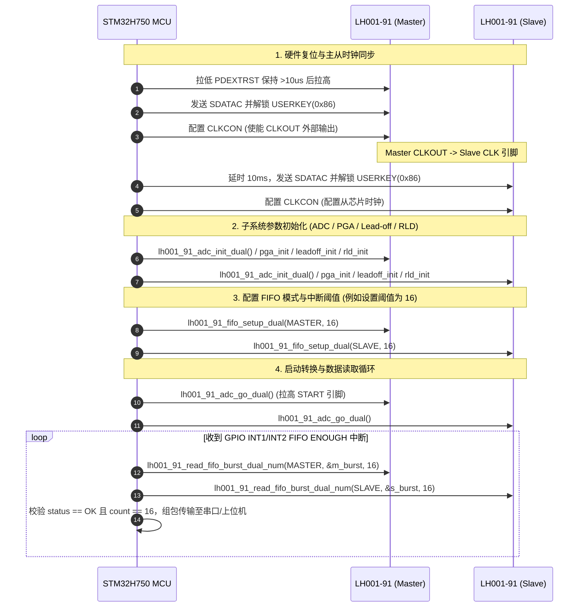

# LH001-91 双芯片 ECG/生物电采集芯片 C 语言驱动 API 文档

本文档整合了 **LH001-91** 双芯片（Master/Slave 主从架构）生物电信号采集芯片的 C 语言驱动文件，包含：
1. **硬件移植层** (`lh001_91_port.h`)
2. **驱动头文件** (`LH001_91.h`)
3. **驱动实现文件** (`LH001_91.c`)

---

## 目录

- [一、 硬件移植层 (`lh001_91_port.h`)](#一-硬件移植层-lh001_91_porth)
- [二、 驱动头文件 (`LH001_91.h`)](#二-驱动头文件-lh001_91h)
- [三、 驱动实现文件 (`LH001_91.c`)](#三-驱动实现文件-lh001_91c)
- [四、 核心 API 说明与驱动调用流程](#四-核心-api-说明与驱动调用流程)

---

## 一、 硬件移植层 (`lh001_91_port.h`)

`lh001_91_port.h` 定义了底层硬件抽象接口，包括 GPIO 片选（CS1/CS2）、复位与启动引脚控制、硬件定时器（TIM17）10μs 微秒延时以及全双工 SPI 字节收发接口。

```c
#ifndef __LH001_91_PORT_H
#define __LH001_91_PORT_H

#ifdef __cplusplus
extern "C" {
#endif

/* Includes ------------------------------------------------------------------*/
#include "stm32h7xx_hal.h"
#include "main.h"

/* 1. SPI 片选使能宏定义 */
#define SPI_CLR_CS1()             HAL_GPIO_WritePin(SPI_CS1_GPIO_Port, SPI_CS1_Pin, GPIO_PIN_RESET)
#define SPI_SET_CS1()             HAL_GPIO_WritePin(SPI_CS1_GPIO_Port, SPI_CS1_Pin, GPIO_PIN_SET)

#define SPI_CLR_CS2()             HAL_GPIO_WritePin(SPI_CS2_GPIO_Port, SPI_CS2_Pin, GPIO_PIN_RESET)
#define SPI_SET_CS2()             HAL_GPIO_WritePin(SPI_CS2_GPIO_Port, SPI_CS2_Pin, GPIO_PIN_SET)

// 兼容单芯片宏定义，默认选通主芯片 CS1
#define SPI_CLR_CS()              SPI_CLR_CS1()
#define SPI_SET_CS()              SPI_SET_CS1()

/* 2. START 引脚控制宏定义 */
#define LH001_91_START_SET()     HAL_GPIO_WritePin(Start_GPIO_Port, Start_Pin, GPIO_PIN_SET)
#define LH001_91_START_CLR()     HAL_GPIO_WritePin(Start_GPIO_Port, Start_Pin, GPIO_PIN_RESET)

/* 3. RESET 硬件复位引脚控制 */
#define LH001_91_PDEXTRST_SET()   HAL_GPIO_WritePin(ECG_Rset_GPIO_Port, ECG_Rset_Pin, GPIO_PIN_SET)
#define LH001_91_PDEXTRST_CLR()   HAL_GPIO_WritePin(ECG_Rset_GPIO_Port, ECG_Rset_Pin, GPIO_PIN_RESET)

/* 4. 软件片选控制使能与哑字节 */
#define SOFTWARE_SPI_CS           1
#define LH001_91_SPI_TX_DUMMY     0x00

/* 5. 10微秒硬件定时器延时函数 (使用 TIM17) */
extern TIM_HandleTypeDef htim17;

void LH001_91_DELAY_INIT(void);

static inline void LH001_91_DELAY_10US(void)
{
    /* 1. 计数器清零 */
    htim17.Instance->CNT = 0;
    
    /* 2. 直接操作 CR1 寄存器启动定时器 (替代 HAL 库抽象开销) */
    htim17.Instance->CR1 |= TIM_CR1_CEN;
    
    /* 3. 阻塞等待 10us，增加超时防御计数，防止定时器异常导致死锁 */
    uint32_t timeout = 100000;
    while ((htim17.Instance->CNT < 10) && (--timeout > 0))
    {
        // 阻塞等待
    }
    
    /* 4. 直接操作 CR1 寄存器停止定时器 */
    htim17.Instance->CR1 &= ~TIM_CR1_CEN;
}

/* 6. SPI 全双工字节收发 */
extern SPI_HandleTypeDef hspi1;

static inline uint8_t stm_lh_spi_txrx8bit(uint8_t tx_byte)
{
    uint8_t rx_byte = 0;
    // 调用 HAL 库同步全双工收发，超时 5ms 以防总线阻塞
    if (HAL_SPI_TransmitReceive(&hspi1, &tx_byte, &rx_byte, 1, 5) != HAL_OK)
    {
        return 0xFF; // 出错或超时返回 0xFF
    }
    return rx_byte;
}

// 映射到驱动上层的宏
#define LH001_91_SpiTxRxByte(tx)  stm_lh_spi_txrx8bit(tx)

#ifdef __cplusplus
}
#endif

#endif /* __LH001_91_PORT_H */
```

---

## 二、 驱动头文件 (`LH001_91.h`)

`LH001_91.h` 定义了 LH001-91 的所有寄存器映射、掩码与位置、命令码、硬件初始化参数结构体、位域帧结构 `ADC_DATA_FIFO_t`、突发读取结构 `LH001_91_FIFO_BURST_t` 以及 API 导出声明。

```c
/**
  ******************************************************************************
  * @file           : LH001_91.h
  * @brief          : LH001-91 ECG Chip Driver Header File (Dual-Chip Master/Slave)
  * @author         : LH Software Group
  ******************************************************************************
  */

#ifndef __LH001_91_H
#define __LH001_91_H

#ifdef __cplusplus
extern "C" {
#endif

/* Includes ------------------------------------------------------------------*/
#include <stdint.h>
#include "lh001_91_port.h"

/* Hardware & Reference Constants --------------------------------------------*/
#define ADC_CONV_START_HW                   1
#define REG_VALUE_TBD                       0x00
#define ADC_REF_MV                          2510

/*******************************************************************************
 * Register Address Definitions
 ******************************************************************************/
#define ADDR_LH001_91_SYSCLK                0x14
#define ADDR_LH001_91_MODCLK                0x15
#define ADDR_LH001_91_CLKCON                0x16
#define ADDR_LH001_91_SPICTRL               0x17
#define ADDR_LH001_91_INTOEN                0x18
#define ADDR_LH001_91_FIFOSTA               0x19
#define ADDR_LH001_91_LOACCLKSEL            0x1A
#define ADDR_LH001_91_OUTCLK                0x1C
#define ADDR_LH001_91_USERKEY               0x1E
#define ADDR_LH001_91_CHIPID                0x40

#define ADDR_LH001_91_CONFIG1               0x01
#define ADDR_LH001_91_ADCCHOP               0x4B
#define ADDR_LH001_91_ADCCTRL               0x0C
#define ADDR_LH001_91_ADCCHCON              0x0B
#define ADDR_LH001_91_BUFCON                0x0A

#define ADDR_LH001_91_PGAGAIN               0x0D
#define ADDR_LH001_91_PGACTRL               0x0E
#define ADDR_LH001_91_PGACTRL1              0x0F

#define ADDR_LH001_91_LOCON1                0x03
#define ADDR_LH001_91_LOCON2                0x04
#define ADDR_LH001_91_LOCON3                0x05
#define ADDR_LH001_91_LOFFSTAT              0x06
#define ADDR_LH001_91_RLDCON                0x07

#define ADDR_LH001_91_PLTFMPD               0x55
#define ADDR_LH001_91_MODCFG                0x64

/*******************************************************************************
 * Register Bit Mask and Position Definitions
 ******************************************************************************/
#define MSK_LH001_91_MODCLK_CD              0xFF
#define POS_LH001_91_MODCLK_CD              0x00

#define MSK_LH001_91_CLKCON_CLKEN           0x01
#define POS_LH001_91_CLKCON_CLKEN           0
#define MSK_LH001_91_CLKCON_F2M             0x02
#define POS_LH001_91_CLKCON_F2M             1
#define MSK_LH001_91_CLKCON_PU              0x04
#define POS_LH001_91_CLKCON_PU              2

#define MSK_LH001_91_SPICTRL_FIFOEN         0x02
#define POS_LH001_91_SPICTRL_FIFOEN         1

#define MSK_LH001_91_INTOEN_INTEN           0x0F
#define POS_LH001_91_INTOEN_INTEN           0
#define MSK_LH001_91_INTOEN_ENOUGH          (0x01 << 1)

#define MSK_LH001_91_FIFOSTA_ENOUGHCNT      (0x1F << 0)
#define POS_LH001_91_FIFOSTA_ENOUGHCNT      (0)
#define LH001_91_FIFO_MAX_DEPTH             32U

/* ADC */
#define MSK_LH001_91_ADCCTRL_ADCEN          (0x01 << 0)
#define POS_LH001_91_ADCCTRL_ADCEN          (0)
#define MSK_LH001_91_ADCCTRL_AMPEN          (0x01 << 1)
#define POS_LH001_91_ADCCTRL_AMPEN          (1)

#define MSK_LH001_91_CONFIG1_DR             (0x07 << 0)
#define MSK_LH001_91_CONFIG1_SGLESHOT       (0x01 << 3)
#define POS_LH001_91_CONFIG1_DR             (0)
#define POS_LH001_91_CONFIG1_SGLESHOT       (3)

#define POS_LH001_91_BUFCON_AVDD_DIV2       (2)
#define MSK_LH001_91_BUFCON_AVDD_DIV2       (1 << POS_LH001_91_BUFCON_AVDD_DIV2)
#define POS_LH001_91_BUFCON_ENREF           (4)
#define MSK_LH001_91_BUFCON_ENREF           (1 << POS_LH001_91_BUFCON_ENREF)
#define POS_LH001_91_BUFCON_EN2P5           (5)
#define MSK_LH001_91_BUFCON_EN2P5           (0x01 << POS_LH001_91_BUFCON_EN2P5)

#define POS_LH001_91_ADCCHCON_PSEL          (0)
#define POS_LH001_91_ADCCHCON_NSEL          (4)

/* PGA */
#define POS_LH001_91_PGACTRL_PD             (0)
#define MSK_LH001_91_PGACTRL_PD             (1 << POS_LH001_91_PGACTRL_PD)
#define POS_LH001_91_PGACTRL_BYPASS         (1)
#define MSK_LH001_91_PGACTRL_BYPASS         (1 << POS_LH001_91_PGACTRL_BYPASS)
#define POS_LH001_91_PGACTRL_LP             (3)
#define MSK_LH001_91_PGACTRL_LP             (1 << POS_LH001_91_PGACTRL_LP)

#define POS_LH001_91_PGACTRL1_CHOP          (0)
#define MSK_LH001_91_PGACTRL1_CHOP          (3 << POS_LH001_91_PGACTRL1_CHOP)
#define POS_LH001_91_PGACTRL1_CMSNS         (2)
#define MSK_LH001_91_PGACTRL1_CMSNS         (1 << POS_LH001_91_PGACTRL1_CMSNS)

#define POS_LH001_91_PGAGAIN                (0)
#define MSK_LH001_91_PGAGAIN                (0x3F << POS_LH001_91_PGAGAIN)

/* ECG */
#define POS_LH001_91_LOCON1_THRESHOLD       (0)
#define POS_LH001_91_LOCON1_CURRENT         (4)
#define POS_LH001_91_LOCON2_SINKEN          (1)
#define MSK_LH001_91_LOCON2_SINKEN          (3 << POS_LH001_91_LOCON2_SINKEN)
#define POS_LH001_91_LOCON2_SOURCEENB       (3)
#define MSK_LH001_91_LOCON2_SOURCEENB       (3 << POS_LH001_91_LOCON2_SOURCEENB)
#define POS_LH001_91_LOCON2_RLDLOEN         (5)
#define MSK_LH001_91_LOCON2_RLDLOEN         (1 << POS_LH001_91_LOCON2_RLDLOEN)

#define POS_LH001_91_LOCON3_DCLOEN          (0)
#define MSK_LH001_91_LOCON3_DCLOEN          (7 << POS_LH001_91_LOCON3_DCLOEN)
#define POS_LH001_91_LOCON3_DCLOEN0         (0)
#define POS_LH001_91_LOCON3_DCLOEN1         (1)
#define POS_LH001_91_LOCON3_DCLOEN2         (2)

#define POS_LH001_91_RLDCON_CHOPFREQ        (0)
#define POS_LH001_91_RLDCON_EN              (2)
#define POS_LH001_91_RLDCON_RLDREFSEL       (3)

/*******************************************************************************
 * Enumeration Definitions
 ******************************************************************************/
#define ENUM_LH001_91_ADC_SINGLE            0x01
#define ENUM_LH001_91_ADC_CONTINOUS         0x00
#define ENUM_LH001_91_ADC_REF_2V            0x00
#define ENUM_LH001_91_ADC_REF_2V5           0x01

#define ENUM_LH001_91_ADCCHP_AIN0           0x00
#define ENUM_LH001_91_ADCCHP_AIN1           0x01
#define ENUM_LH001_91_ADCCHN_AIN0           0x00
#define ENUM_LH001_91_ADCCHN_AIN1           0x01

#define ENUM_LH001_91_PGA_PGAGAIN_6         0x04
#define ENUM_LH001_91_PGA_POWER_LP          0x01
#define ENUM_LH001_91_PGA_CHOP_DIV16        2

#define LH001_91_USERKEY                    0x86
#define ENUM_LH001_91_RLD_CHOP_CLOSE        0
#define ENUM_LH001_91_RLD_CHOP_FMOD_DIV32   1
#define ENUM_LH001_91_RLD_REF_AVDD_DIV2     0

/*******************************************************************************
 * SPI Command Opcodes
 ******************************************************************************/
#define SPI_CMD_RESET                       0x06
#define SPI_CMD_CONV_START                  0x08
#define SPI_CMD_CONV_STOP                   0x0A
#define SPI_CMD_RST_FIFO                    0x0C
#define SPI_CMD_RDATAC                      0x10
#define SPI_CMD_SDATAC                      0x11
#define SPI_CMD_RDATA                       0x12
#define SPI_CMD_RREG_MSK                    0x20
#define SPI_CMD_WREG_MSK                    0x40
#define SPI_CMD_RREG_BK1_MSK                0xA0
#define SPI_CMD_WREG_BK1_MSK                0xC0

/*******************************************************************************
 * Configuration Structure Constants
 ******************************************************************************/
#define ENUM_LH001_91_ADC_FMODCLK_128K      16
#define ENUM_LH001_91_ADC_DR_DIV128         3

#define LH001_91_LEADOFF_DELTA_4            3
#define LH001_91_LEADOFF_CURRENT_SOURCE_50nA 3
#define LH001_91_LEADOFF_SINK_CLOSE         0
#define LH001_91_LEADOFF_SOURCE_CLOSE       3

/*******************************************************************************
 * Type Definitions & Structures
 ******************************************************************************/
typedef struct {
    uint32_t Fmodclk;
    uint32_t oversample_rate;
    uint32_t conv_mode;
    uint32_t ref_sel;
} LH001_91_ADC_INIT_t;

typedef struct {
    uint32_t gain;
    uint32_t pga_bypass;
    uint32_t pga_chop;
    uint32_t power_mode;
    uint32_t comm_sense_en;
} LH001_91_PGA_INIT_t;

typedef struct {
    uint32_t threshold;
    uint32_t current;
    uint32_t sink_cfg;
    uint32_t source_cfg;
    uint32_t rld_sink_en;
    uint32_t ain0_detect_en;
    uint32_t ain1_detect_en;
    uint32_t rld_detect_en; 
} LH001_91_LEADOFF_t;

typedef enum {
    LH001_91_CHIP_MASTER = 0,  // 选择主芯片 (CS1 -> PA4)
    LH001_91_CHIP_SLAVE  = 1   // 选择从芯片 (CS2 -> PA1)
} LH001_91_Chip_ID_t;

typedef struct {
    volatile uint64_t reserved0 : 48;
    volatile uint64_t start     : 4;
    volatile uint64_t loffstat  : 6;
    volatile uint64_t gpio      : 2;
    volatile uint64_t reserved1 : 10;
    volatile uint64_t data      : 24;
    volatile uint64_t tail      : 2;
} ADC_DATA_FIFO_t;

typedef enum {
    LH001_91_FIFO_READ_OK = 0,
    LH001_91_FIFO_READ_OVERFLOW,
    LH001_91_FIFO_READ_EMPTY,
    LH001_91_FIFO_READ_NO_TAIL,
    LH001_91_FIFO_READ_BAD_ARG,
} LH001_91_FIFO_READ_STATUS_t;

typedef struct {
    ADC_DATA_FIFO_t frames[LH001_91_FIFO_MAX_DEPTH];
    uint8_t data_buf[LH001_91_FIFO_MAX_DEPTH * 6];
    uint8_t count;
    uint8_t last_tail;
    LH001_91_FIFO_READ_STATUS_t status;
} LH001_91_FIFO_BURST_t;

/*******************************************************************************
 * Clean API Declarations
 ******************************************************************************/
void lh001_91_hw_reset(void);
void lh001_91_adc_go_dual(LH001_91_Chip_ID_t chip_id);
void lh001_91_adc_stop_dual(LH001_91_Chip_ID_t chip_id);

void lh001_91_reset_fifo_hw(void);
void lh001_91_reset_fifo_cmd_dual(LH001_91_Chip_ID_t chip_id);
void lh001_91_reset_fifo_cmd(void);

void lh001_91_write_regs_dual(LH001_91_Chip_ID_t chip_id, uint8_t addr, uint8_t *pRegs, uint8_t num);
void lh001_91_read_regs_dual(LH001_91_Chip_ID_t chip_id, uint8_t addr, uint8_t *pRegs, uint8_t num);

void lh001_91_fifo_setup_dual(LH001_91_Chip_ID_t chip_id, uint8_t thresh_num);
void lh001_91_read_fifo_burst_dual_num(LH001_91_Chip_ID_t chip_id, LH001_91_FIFO_BURST_t *pBurst, uint8_t expected_count);

void lh001_91_adc_init_dual(LH001_91_Chip_ID_t chip_id, LH001_91_ADC_INIT_t *pInit);
void lh001_91_pga_init_dual(LH001_91_Chip_ID_t chip_id, LH001_91_PGA_INIT_t *pInit);
void lh001_91_leadoff_init_dual(LH001_91_Chip_ID_t chip_id, LH001_91_LEADOFF_t *pInit);
void lh001_91_rld_init_dual(LH001_91_Chip_ID_t chip_id, uint32_t enable, uint32_t refsel, uint32_t chop);
void lh001_91_adc_channel_dual(LH001_91_Chip_ID_t chip_id, uint32_t chP, uint32_t chN);

float lh001_91_adc_code2mv(uint32_t code, uint32_t ref);

#ifdef __cplusplus
}
#endif

#endif  /* __LH001_91_H */
```

---

## 三、 驱动实现文件 (`LH001_91.c`)

`LH001_91.c` 实现了完整的硬件初始化复位序列、主从芯片时钟同步（Master 输出 CLKOUT 供给 Slave）、带分页扩充 Banking 的寄存器读写算法、FIFO 水位线配置与 6 字节突发数据包的软硬件解码解析，以及 ADC 电压转换换算。

```c
/**
  ******************************************************************************
  * @file           : LH001_91.c
  * @brief          : LH001-91 ECG Chip Driver Implementation (Dual-Chip Master/Slave)
  * @author         : LH Software Group
  ******************************************************************************
  */

#include "LH001_91.h"
#include <string.h>

/* Private Helper Functions --------------------------------------------------*/

static void lh001_91_cs_clr(LH001_91_Chip_ID_t chip_id)
{
    if (chip_id == LH001_91_CHIP_MASTER) {
        SPI_CLR_CS1();
    } else if (chip_id == LH001_91_CHIP_SLAVE) {
        SPI_CLR_CS2();
    }
}

static void lh001_91_cs_set(LH001_91_Chip_ID_t chip_id)
{
    if (chip_id == LH001_91_CHIP_MASTER) {
        SPI_SET_CS1();
    } else if (chip_id == LH001_91_CHIP_SLAVE) {
        SPI_SET_CS2();
    }
}

/* ============================================================================
 * 1. Hardware Reset & ADC Control Functions
 * ============================================================================ */

void lh001_91_hw_reset(void)
{
    /* 1. 上电建立 (Power-On Setup) */
    LH001_91_START_CLR();       // 保持 START 引脚为低电平
    SPI_SET_CS1();              // 释放主芯片片选
    SPI_SET_CS2();              // 释放从芯片片选
    LH001_91_PDEXTRST_SET();    // 保持复位引脚为高电平
    HAL_Delay(3);               // 延时 3ms，等待上电稳定（手册要求 > 2.5ms）

    /* 2. 硬件复位 (Hardware Reset Pulse) */
    LH001_91_PDEXTRST_CLR();    // 产生复位低电平脉冲
    LH001_91_DELAY_10US();
    LH001_91_DELAY_10US();
    LH001_91_DELAY_10US();      // 延时 30us，确保低电平脉宽 > 10us
    
    LH001_91_PDEXTRST_SET();    // 拉高复位引脚
    HAL_Delay(10);              // 延时 10ms

    /* 2.5. 停止主芯片转换 (Stop Master Conversion) */
    SPI_CLR_CS1();
    LH001_91_SpiTxRxByte(SPI_CMD_CONV_STOP);
    SPI_SET_CS1();
    LH001_91_DELAY_10US();

    /* 3. 解锁主片 (Unlock Master - SDATAC) */
    SPI_CLR_CS1();
    LH001_91_SpiTxRxByte(SPI_CMD_SDATAC);
    SPI_SET_CS1();
    LH001_91_DELAY_10US();

    /* 4. 主片供钟 (Configure Master to Output Clock) */
    SPI_CLR_CS1();
    LH001_91_SpiTxRxByte(0x5E); // WREG USERKEY (0x1E)
    LH001_91_SpiTxRxByte(0x00);
    LH001_91_SpiTxRxByte(0x86); // 解锁码 0x86
    SPI_SET_CS1();
    LH001_91_DELAY_10US();

    SPI_CLR_CS1();
    LH001_91_SpiTxRxByte(0x56); // WREG CLKCON (0x16)
    LH001_91_SpiTxRxByte(0x00);
    LH001_91_SpiTxRxByte(0x01); // 使能 CLKOUT
    SPI_SET_CS1();
    LH001_91_DELAY_10US();

    /* 5. 解锁从片 (Unlock Slave - SDATAC) */
    HAL_Delay(10);               // 等待主片输出时钟稳定供给从片
    SPI_CLR_CS2();
    LH001_91_SpiTxRxByte(SPI_CMD_CONV_STOP);
    SPI_SET_CS2();
    LH001_91_DELAY_10US();

    SPI_CLR_CS2();
    LH001_91_SpiTxRxByte(SPI_CMD_SDATAC);
    SPI_SET_CS2();
    LH001_91_DELAY_10US();

    /* 6. 配置从芯片 CLKCON */
    SPI_CLR_CS2();
    LH001_91_SpiTxRxByte(0x5E); // WREG USERKEY
    LH001_91_SpiTxRxByte(0x00);
    LH001_91_SpiTxRxByte(0x86);
    SPI_SET_CS2();
    LH001_91_DELAY_10US();

    SPI_CLR_CS2();
    LH001_91_SpiTxRxByte(0x56); // WREG CLKCON
    LH001_91_SpiTxRxByte(0x00);
    LH001_91_SpiTxRxByte(0x01);
    SPI_SET_CS2();
    LH001_91_DELAY_10US();
}

void lh001_91_adc_go_dual(LH001_91_Chip_ID_t chip_id)
{
#if ADC_CONV_START_HW
    LH001_91_START_SET();
#else
    lh001_91_cs_clr(chip_id);
    LH001_91_DELAY_10US();

    LH001_91_SpiTxRxByte(SPI_CMD_CONV_START);
    LH001_91_DELAY_10US();
    lh001_91_cs_set(chip_id);
#endif
}

void lh001_91_adc_stop_dual(LH001_91_Chip_ID_t chip_id)
{
#if ADC_CONV_START_HW
    LH001_91_START_CLR();
#else
    lh001_91_cs_clr(chip_id);
    LH001_91_DELAY_10US();

    LH001_91_SpiTxRxByte(SPI_CMD_CONV_STOP);
    LH001_91_DELAY_10US();
    lh001_91_cs_set(chip_id);
#endif
}

void lh001_91_reset_fifo_hw(void) 
{
#if ADC_CONV_START_HW
    LH001_91_START_CLR();
    LH001_91_DELAY_10US();
    LH001_91_START_SET();
#else
    lh001_91_adc_stop_dual(LH001_91_CHIP_MASTER);
    lh001_91_adc_stop_dual(LH001_91_CHIP_SLAVE);
    LH001_91_DELAY_10US();
    lh001_91_adc_go_dual(LH001_91_CHIP_MASTER);
    lh001_91_adc_go_dual(LH001_91_CHIP_SLAVE);
#endif
}

void lh001_91_reset_fifo_cmd_dual(LH001_91_Chip_ID_t chip_id)
{
    lh001_91_cs_clr(chip_id);
    LH001_91_DELAY_10US();
    LH001_91_SpiTxRxByte(SPI_CMD_RST_FIFO);
    LH001_91_DELAY_10US();
    lh001_91_cs_set(chip_id);
}

void lh001_91_reset_fifo_cmd(void)
{
    lh001_91_reset_fifo_cmd_dual(LH001_91_CHIP_MASTER);
    lh001_91_reset_fifo_cmd_dual(LH001_91_CHIP_SLAVE);
}

/* ============================================================================
 * 2. Register Read & Write Functions (Supports Dual-Chip & Banking)
 * ============================================================================ */

void lh001_91_write_regs_dual(LH001_91_Chip_ID_t chip_id, uint8_t addr, uint8_t *pRegs, uint8_t num)
{
    if (pRegs == NULL || num == 0) {
        return;
    }
    uint8_t *p = pRegs;
    uint8_t reg_addr;
#if SOFTWARE_SPI_CS
    lh001_91_cs_clr(chip_id);
    LH001_91_DELAY_10US();
#endif

    reg_addr = addr & 0x1F;

    if (addr < 32) {
        LH001_91_SpiTxRxByte(SPI_CMD_WREG_MSK | reg_addr);
        LH001_91_SpiTxRxByte(num - 1);
        for (uint8_t i = 0; i < num; i++) {
            LH001_91_SpiTxRxByte(p[i]);
        }
    } else if (addr < 63) {
        LH001_91_SpiTxRxByte(SPI_CMD_WREG_BK1_MSK | reg_addr);
        LH001_91_SpiTxRxByte(num - 1);
        for (uint8_t i = 0; i < num; i++) {
            LH001_91_SpiTxRxByte(p[i]);
        }
    } else if (addr == 63) {
        LH001_91_SpiTxRxByte(SPI_CMD_WREG_BK1_MSK | reg_addr);
        LH001_91_SpiTxRxByte(0);
        LH001_91_SpiTxRxByte(0x72);
        LH001_91_SpiTxRxByte(p[0]);
    } else {
        // extend address mapping
        LH001_91_SpiTxRxByte(SPI_CMD_WREG_BK1_MSK | 31);
        LH001_91_SpiTxRxByte(0);
        LH001_91_SpiTxRxByte(0x72);
        LH001_91_SpiTxRxByte(0x01);

#if SOFTWARE_SPI_CS
        LH001_91_DELAY_10US();
        lh001_91_cs_set(chip_id);
#endif

#if SOFTWARE_SPI_CS
        lh001_91_cs_clr(chip_id);
        LH001_91_DELAY_10US();
#endif

        if (addr < (64 + 32)) {
            LH001_91_SpiTxRxByte(SPI_CMD_WREG_MSK | reg_addr);
        } else {
            LH001_91_SpiTxRxByte(SPI_CMD_WREG_BK1_MSK | reg_addr);
        }
        LH001_91_SpiTxRxByte(num - 1);
        for (uint8_t i = 0; i < num; i++) {
            LH001_91_SpiTxRxByte(p[i]);
        }

#if SOFTWARE_SPI_CS
        LH001_91_DELAY_10US();
        lh001_91_cs_set(chip_id);
#endif

        // clear address extension
#if SOFTWARE_SPI_CS
        lh001_91_cs_clr(chip_id);
        LH001_91_DELAY_10US();
#endif

        LH001_91_SpiTxRxByte(SPI_CMD_WREG_BK1_MSK | 31);
        LH001_91_SpiTxRxByte(0);
        LH001_91_SpiTxRxByte(0x72);
        LH001_91_SpiTxRxByte(0x00);
    }

#if SOFTWARE_SPI_CS
    LH001_91_DELAY_10US();
    lh001_91_cs_set(chip_id);
#endif
}

void lh001_91_read_regs_dual(LH001_91_Chip_ID_t chip_id, uint8_t addr, uint8_t *pRegs, uint8_t num)
{
    if (pRegs == NULL || num == 0) {
        return;
    }
    uint8_t *p = pRegs;
    uint8_t reg_addr;
#if SOFTWARE_SPI_CS
    lh001_91_cs_clr(chip_id);
    LH001_91_DELAY_10US();
#endif
    reg_addr = addr & 0x1F;

    if (addr < 32) {
        LH001_91_SpiTxRxByte(SPI_CMD_RREG_MSK | reg_addr);
        LH001_91_SpiTxRxByte(num - 1);
        for (uint8_t i = 0; i < num; i++) {
            p[i] = LH001_91_SpiTxRxByte(LH001_91_SPI_TX_DUMMY);
        }
    } else if (addr < 63) {
        LH001_91_SpiTxRxByte(SPI_CMD_RREG_BK1_MSK | reg_addr);
        LH001_91_SpiTxRxByte(num - 1);
        for (uint8_t i = 0; i < num; i++) {
            p[i] = LH001_91_SpiTxRxByte(LH001_91_SPI_TX_DUMMY);
        }
    } else if (addr == 63) {
        LH001_91_SpiTxRxByte(SPI_CMD_RREG_BK1_MSK | reg_addr);
        LH001_91_SpiTxRxByte(0);
        LH001_91_SpiTxRxByte(0x72);
        p[0] = LH001_91_SpiTxRxByte(LH001_91_SPI_TX_DUMMY);
    } else {
        // extend address mapping
        LH001_91_SpiTxRxByte(SPI_CMD_WREG_BK1_MSK | 31);
        LH001_91_SpiTxRxByte(0);
        LH001_91_SpiTxRxByte(0x72);
        LH001_91_SpiTxRxByte(0x01);

#if SOFTWARE_SPI_CS
        LH001_91_DELAY_10US();
        lh001_91_cs_set(chip_id);
#endif

#if SOFTWARE_SPI_CS
        lh001_91_cs_clr(chip_id);
        LH001_91_DELAY_10US();
#endif

        if (addr < (64 + 32)) {
            LH001_91_SpiTxRxByte(SPI_CMD_RREG_MSK | reg_addr);
        } else {
            LH001_91_SpiTxRxByte(SPI_CMD_RREG_BK1_MSK | reg_addr);
        }
        LH001_91_SpiTxRxByte(num - 1);
        for (uint8_t i = 0; i < num; i++) {
            p[i] = LH001_91_SpiTxRxByte(LH001_91_SPI_TX_DUMMY);
        }

#if SOFTWARE_SPI_CS
        LH001_91_DELAY_10US();
        lh001_91_cs_set(chip_id);
#endif

        // clear address extension
#if SOFTWARE_SPI_CS
        lh001_91_cs_clr(chip_id);
        LH001_91_DELAY_10US();
#endif

        LH001_91_SpiTxRxByte(SPI_CMD_WREG_BK1_MSK | 31);
        LH001_91_SpiTxRxByte(0);
        LH001_91_SpiTxRxByte(0x72);
        LH001_91_SpiTxRxByte(0x00);
    }

#if SOFTWARE_SPI_CS
    LH001_91_DELAY_10US();
    lh001_91_cs_set(chip_id);
#endif
}

/* ============================================================================
 * 3. FIFO Setup & Burst Reading Functions
 * ============================================================================ */

void lh001_91_fifo_setup_dual(LH001_91_Chip_ID_t chip_id, uint8_t thresh_num)
{
    uint8_t val;

    /* 1. 使能 FIFO (FIFO_SEL = 1) */
    lh001_91_read_regs_dual(chip_id, ADDR_LH001_91_SPICTRL, &val, 1);
    val |= MSK_LH001_91_SPICTRL_FIFOEN;
    val &= ~(1U << 2);
    lh001_91_write_regs_dual(chip_id, ADDR_LH001_91_SPICTRL, &val, 1);

    /* 2. 配置 INTOEN：保留高 4 位，低 4 位使能 ENOUGH 中断 (0x02) */
    lh001_91_read_regs_dual(chip_id, ADDR_LH001_91_INTOEN, &val, 1);
    val &= ~MSK_LH001_91_INTOEN_INTEN;
    val |= MSK_LH001_91_INTOEN_ENOUGH;
    lh001_91_write_regs_dual(chip_id, ADDR_LH001_91_INTOEN, &val, 1);

    /* 3. 配置 FIFOSTA：设置 Enough_Int_threshold 点数为 (thresh_num - 1) */
    lh001_91_read_regs_dual(chip_id, ADDR_LH001_91_FIFOSTA, &val, 1);
    val &= ~MSK_LH001_91_FIFOSTA_ENOUGHCNT;
    uint8_t cnt_val = (thresh_num > 0) ? (thresh_num - 1) : 0;
    val |= (cnt_val & MSK_LH001_91_FIFOSTA_ENOUGHCNT);
    lh001_91_write_regs_dual(chip_id, ADDR_LH001_91_FIFOSTA, &val, 1);
}

static void lh001_91_read_data_fifo_dual_raw(LH001_91_Chip_ID_t chip_id, ADC_DATA_FIFO_t *pData, uint8_t raw_buf[6])
{
    if (pData == NULL) {
        return;
    }

    uint8_t dat[6];

#if SOFTWARE_SPI_CS
    lh001_91_cs_clr(chip_id);
    LH001_91_DELAY_10US();
#endif

    LH001_91_SpiTxRxByte(SPI_CMD_RDATA);
    for (uint32_t i = 0; i < 6; i++) {
        dat[i] = LH001_91_SpiTxRxByte(LH001_91_SPI_TX_DUMMY);
        if (raw_buf != NULL) {
            raw_buf[i] = dat[i];
        }
    }

#if SOFTWARE_SPI_CS
    LH001_91_DELAY_10US();
    lh001_91_cs_set(chip_id);
#endif

    pData->reserved0 = 0;
    pData->start = dat[0] >> 4;
    pData->loffstat = ((dat[0] & 0x0F) << 2) | (dat[1] >> 6);
    pData->gpio = (dat[1] >> 4) & 0x03;
    pData->reserved1 = ((dat[1] & 0x1F) << 8) | (dat[2] >> 2);
    pData->data = ((dat[2] & 0x03) << 22) | (dat[3] << 14) | (dat[4] << 6) | (dat[5] >> 2);
    pData->tail = dat[5] & 0x03;
}

void lh001_91_read_fifo_burst_dual_num(LH001_91_Chip_ID_t chip_id, LH001_91_FIFO_BURST_t *pBurst, uint8_t expected_count)
{
    uint8_t i;

    if (pBurst == NULL || expected_count == 0 || expected_count > LH001_91_FIFO_MAX_DEPTH) {
        return;
    }

    memset(pBurst, 0, sizeof(*pBurst));
    pBurst->status = LH001_91_FIFO_READ_OK;

    for (i = 0; i < expected_count; i++) {
        lh001_91_read_data_fifo_dual_raw(chip_id, &pBurst->frames[i], &pBurst->data_buf[i * 6]);
        pBurst->count++;
        pBurst->last_tail = pBurst->frames[i].tail;

        if (pBurst->frames[i].tail == 0x02) { // EMPTY
            pBurst->status = LH001_91_FIFO_READ_EMPTY;
            break;
        }

        if (pBurst->frames[i].tail == 0x03) { // OVERFLOW
            pBurst->status = LH001_91_FIFO_READ_OVERFLOW;
            break;
        }

        if (pBurst->frames[i].tail == 0x01) { // 本批次末尾点
            pBurst->status = LH001_91_FIFO_READ_OK;
            break;
        }
    }
}

/* ============================================================================
 * 4. Subsystem Initializations (ADC, PGA, Lead-Off, RLD)
 * ============================================================================ */

void lh001_91_adc_init_dual(LH001_91_Chip_ID_t chip_id, LH001_91_ADC_INIT_t *pInit)
{
    uint8_t val;

    lh001_91_read_regs_dual(chip_id, ADDR_LH001_91_MODCLK, &val, 1);
    val &= ~MSK_LH001_91_MODCLK_CD;
    val |= pInit->Fmodclk << POS_LH001_91_MODCLK_CD;
    lh001_91_write_regs_dual(chip_id, ADDR_LH001_91_MODCLK, &val, 1);

    lh001_91_read_regs_dual(chip_id, ADDR_LH001_91_BUFCON, &val, 1);
    val &= ~(MSK_LH001_91_BUFCON_EN2P5);
    val |= (pInit->ref_sel << POS_LH001_91_BUFCON_EN2P5) | MSK_LH001_91_BUFCON_AVDD_DIV2 | MSK_LH001_91_BUFCON_ENREF;
    lh001_91_write_regs_dual(chip_id, ADDR_LH001_91_BUFCON, &val, 1);

    lh001_91_read_regs_dual(chip_id, ADDR_LH001_91_CONFIG1, &val, 1);
    val &= ~(MSK_LH001_91_CONFIG1_DR | MSK_LH001_91_CONFIG1_SGLESHOT);
    val |= (pInit->oversample_rate << POS_LH001_91_CONFIG1_DR) | (pInit->conv_mode << POS_LH001_91_CONFIG1_SGLESHOT);
    lh001_91_write_regs_dual(chip_id, ADDR_LH001_91_CONFIG1, &val, 1);

    lh001_91_read_regs_dual(chip_id, ADDR_LH001_91_ADCCTRL, &val, 1);
    val |= (MSK_LH001_91_ADCCTRL_ADCEN | MSK_LH001_91_ADCCTRL_AMPEN);
    lh001_91_write_regs_dual(chip_id, ADDR_LH001_91_ADCCTRL, &val, 1);
}

void lh001_91_pga_init_dual(LH001_91_Chip_ID_t chip_id, LH001_91_PGA_INIT_t *pInit)
{
    uint8_t val;

    val = (pInit->gain) & MSK_LH001_91_PGAGAIN;
    lh001_91_write_regs_dual(chip_id, ADDR_LH001_91_PGAGAIN, &val, 1);

    lh001_91_read_regs_dual(chip_id, ADDR_LH001_91_PGACTRL1, &val, 1);
    val &= ~(MSK_LH001_91_PGACTRL1_CHOP | MSK_LH001_91_PGACTRL1_CMSNS);
    val |= (pInit->comm_sense_en << POS_LH001_91_PGACTRL1_CMSNS) | (pInit->pga_chop << POS_LH001_91_PGACTRL1_CHOP);
    lh001_91_write_regs_dual(chip_id, ADDR_LH001_91_PGACTRL1, &val, 1);

    val = (pInit->pga_bypass << POS_LH001_91_PGACTRL_BYPASS) | (pInit->power_mode << POS_LH001_91_PGACTRL_LP);
    val &= ~MSK_LH001_91_PGACTRL_PD; // 使能 PGA
    lh001_91_write_regs_dual(chip_id, ADDR_LH001_91_PGACTRL, &val, 1);
}

void lh001_91_leadoff_init_dual(LH001_91_Chip_ID_t chip_id, LH001_91_LEADOFF_t *pInit)
{
    uint8_t val;

    val = ((pInit->threshold) << POS_LH001_91_LOCON1_THRESHOLD) | (pInit->current << POS_LH001_91_LOCON1_CURRENT);
    lh001_91_write_regs_dual(chip_id, ADDR_LH001_91_LOCON1, &val, 1);

    lh001_91_read_regs_dual(chip_id, ADDR_LH001_91_LOCON2, &val, 1);
    val &= ~(MSK_LH001_91_LOCON2_SINKEN | MSK_LH001_91_LOCON2_SOURCEENB | MSK_LH001_91_LOCON2_RLDLOEN);
    val |= (pInit->sink_cfg << POS_LH001_91_LOCON2_SINKEN) \
          | (pInit->source_cfg << POS_LH001_91_LOCON2_SOURCEENB) \
          | (pInit->rld_sink_en << POS_LH001_91_LOCON2_RLDLOEN);
    lh001_91_write_regs_dual(chip_id, ADDR_LH001_91_LOCON2, &val, 1);

    lh001_91_read_regs_dual(chip_id, ADDR_LH001_91_LOCON3, &val, 1);
    val &= ~MSK_LH001_91_LOCON3_DCLOEN;
    val |= (pInit->ain0_detect_en << POS_LH001_91_LOCON3_DCLOEN0) \
           | (pInit->rld_detect_en << POS_LH001_91_LOCON3_DCLOEN1) \
           | (pInit->ain1_detect_en << POS_LH001_91_LOCON3_DCLOEN2);
    lh001_91_write_regs_dual(chip_id, ADDR_LH001_91_LOCON3, &val, 1);
}

void lh001_91_rld_init_dual(LH001_91_Chip_ID_t chip_id, uint32_t enable, uint32_t refsel, uint32_t chop)
{
    uint8_t val;
    val = (enable << POS_LH001_91_RLDCON_EN) \
          | (refsel << POS_LH001_91_RLDCON_RLDREFSEL) \
          | (chop << POS_LH001_91_RLDCON_CHOPFREQ);
    lh001_91_write_regs_dual(chip_id, ADDR_LH001_91_RLDCON, &val, 1);
}

void lh001_91_adc_channel_dual(LH001_91_Chip_ID_t chip_id, uint32_t chP, uint32_t chN)
{
    uint8_t val;
    val = (chP << POS_LH001_91_ADCCHCON_PSEL) \
          | (chN << POS_LH001_91_ADCCHCON_NSEL);
    lh001_91_write_regs_dual(chip_id, ADDR_LH001_91_ADCCHCON, &val, 1);
}

float lh001_91_adc_code2mv(uint32_t code, uint32_t ref)
{
    int32_t dat;
    float rlt;
    if (code & (1 << 23)) {
        dat = (int32_t)((0xFFuL << 24) | code);
    } else {
        dat = (int32_t)code;
    }
    rlt = (float)dat * 2.0f * (float)ref / (6.0f * 16777215.0f);
    return rlt;
}
```

---

## 四、 核心 API 说明与驱动调用流程

### 1. API 接口函数汇总表

| 函数名称 | 功能简述 | 关键参数 / 说明 |
| :--- | :--- | :--- |
| `lh001_91_hw_reset()` | 硬件上电与复位序列 | 执行硬件复位脉冲，解锁主从片并配置主芯片 `CLKOUT` 稳定输出时钟供给从芯片 |
| `lh001_91_adc_go_dual(chip_id)` | 启动 ADC 采样转换 | 控制 `START` 引脚拉高或发送 `CONV_START` SPI 命令 |
| `lh001_91_adc_stop_dual(chip_id)` | 停止 ADC 采样转换 | 控制 `START` 引脚拉低或发送 `CONV_STOP` SPI 命令 |
| `lh001_91_reset_fifo_hw()` | 硬件复位 FIFO | 快速翻转 `START` 引脚拉低再拉高以清空芯片内部 FIFO |
| `lh001_91_reset_fifo_cmd_dual(chip_id)` | SPI 命令复位单个芯片 FIFO | 发送 `0x0C` (`SPI_CMD_RST_FIFO`) 复位指定芯片 FIFO |
| `lh001_91_reset_fifo_cmd()` | SPI 命令复位双芯片 FIFO | 依次向主片和从片发送 `0x0C` 命令 |
| `lh001_91_write_regs_dual(chip_id, addr, pRegs, num)` | 写寄存器（支持分页扩充） | 支持 0~31 (Page0), 32~62 (Bank1), 63 (Key), $\ge 64$ (扩展页) 的连写操作 |
| `lh001_91_read_regs_dual(chip_id, addr, pRegs, num)` | 读寄存器（支持分页扩充） | 支持指定芯片的寄存器连续读取 |
| `lh001_91_fifo_setup_dual(chip_id, thresh_num)` | 配置 FIFO 模式与中断水位线 | 使能 `SPICTRL.FIFOEN`、设置 `INTOEN.ENOUGH` 中断，并配置 `FIFOSTA` 水位线 |
| `lh001_91_read_fifo_burst_dual_num(chip_id, pBurst, expected_count)` | 突发读取指定点数 FIFO 数据 | 读取 6 字节/帧的 FIFO 突发数据并实时解码 `loffstat`, `data`, `tail` |
| `lh001_91_adc_init_dual(chip_id, pInit)` | 初始化 ADC 子系统 | 设置调制解调时钟 `Fmodclk`、参考电压 `ref_sel`、采样率与转换模式 |
| `lh001_91_pga_init_dual(chip_id, pInit)` | 初始化 PGA 前置放大器 | 设置增益 `gain`、斩波 `pga_chop`、低功耗模式与通道使能 |
| `lh001_91_leadoff_init_dual(chip_id, pInit)` | 初始化导联脱落检测 (Lead-off) | 设置检测电流/门限，使能 AIN0/AIN1/RLD 导联脱落检测 |
| `lh001_91_rld_init_dual(chip_id, enable, refsel, chop)` | 初始化右腿驱动 (RLD) | 设置 RLD 放大器使能、基准选通与斩波频率 |
| `lh001_91_adc_channel_dual(chip_id, chP, chN)` | 选通 ADC 正负输入通道 | 配置 `ADCCHCON` 寄存器选通通道 |
| `lh001_91_adc_code2mv(code, ref)` | 24位有符号 ADC 原始 Code 转 mV | 将 24位有符号 Code 结合 PGA 增益(6x) 转换为真实毫伏电压值 |

### 2. 经典初始化与数据采集调用流程


